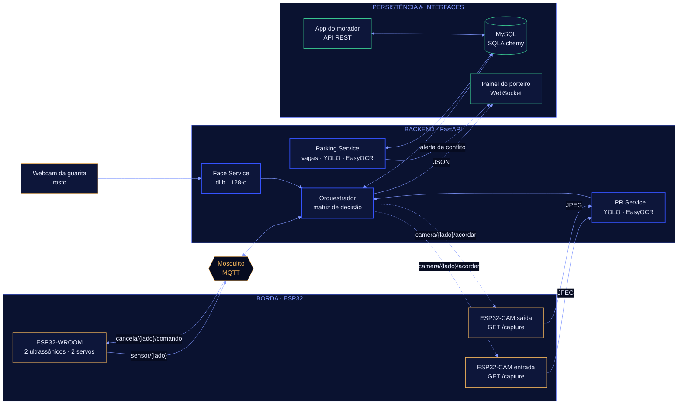
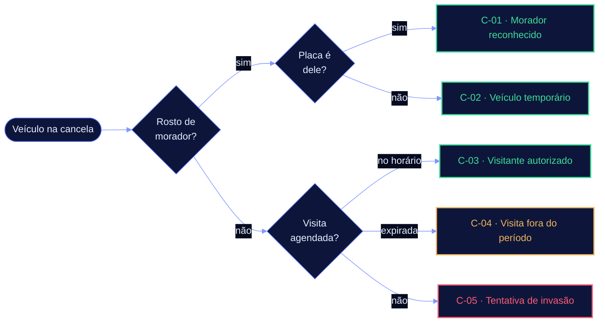

<div align="center">
  
  <br><br>
  
  
  
  
  
  
  <br><br>
  <a href="https://parksync-landing-page.onrender.com/"></a>
  <br><br>
  <code>TCC</code> · <code>2026</code>
</div>

<br>

> ### A segurança condominial, *redefinida*.
>
> Sem cancela manual, sem totem de ticket: uma **matriz de decisão biométrica** que cruza rosto e placa, registra cada acesso e avisa a portaria em tempo real.
>
> *Desenvolvido como requisito para o título de Técnico em Desenvolvimento de Sistemas.*
>
> 🌐 **Conheça o projeto de forma interativa:** a [landing page do ParkSync](https://parksync-landing-page.onrender.com/) traz o diagrama da arquitetura animado, um simulador da matriz de decisão e o mapa de vagas.

<div align="center">

| `2` fatores | `5` cenários | `3` ESP32 | `RT` WebSocket |
| :---: | :---: | :---: | :---: |
| rosto do morador + placa do veículo dele | na matriz de decisão da portaria | na borda: WROOM + duas ESP32-CAM | eventos ao vivo no painel do porteiro |

</div>

<div align="center">
<code>──●────────────┬────────────●────────────┬────────────●──</code>
</div>

## `01` · Visão

| | Antes · portaria analógica | | Depois · ParkSync |
| :--- | :--- | :--- | :--- |
| `P-01` | **Credenciais que se copiam.** Controle remoto, tag e cartão podem ser clonados, emprestados ou perdidos. Quem segura o objeto entra, seja quem for. | `S-01` | **Dupla checagem biométrica.** A cancela só abre quando o rosto reconhecido e a placa lida pertencem ao mesmo morador, ou quando há visita agendada válida. |
| `P-02` | **Conferência no olho.** A portaria depende da atenção de uma pessoa para comparar rosto, placa e lista de visitas, a qualquer hora do dia. | `S-02` | **Trilha de auditoria.** Cada decisão da portaria, automática ou manual, vira um registro com direção, tipo, motivo e horário. |
| `P-03` | **Pátio sem controle.** Vaga ocupada pelo carro errado só é descoberta quando o morador chega e encontra o espaço tomado. | `S-03` | **Pátio monitorado.** Uma câmera acompanha as vagas, lê a placa de quem estacionou e avisa o painel quando o carro não é do apartamento da vaga. |

<div align="center">
<code>──●────────────┬────────────●────────────┬────────────●──</code>
</div>

## `02` · Arquitetura

### Borda IoT que escuta, *backend* que decide.

O ESP32-WROOM percebe o veículo e avisa o backend pelo **MQTT**. O orquestrador acorda a ESP32-CAM do lado certo, que entrega a foto da placa por **HTTP**, enquanto a webcam da guarita captura o rosto. A decisão sai em JSON por **WebSocket** para o painel do porteiro; o app do morador conversa com o backend pela **API REST**.



<details>
<summary><b>Fluxo de entrada, passo a passo</b></summary>
<br>

| # | Etapa | O que acontece |
| :---: | :--- | :--- |
| `1` | **Presença detectada** | O ultrassônico da cancela percebe o veículo e o ESP32-WROOM publica o evento no broker MQTT. |
| `2` | **Câmera acordada** | O orquestrador manda a ESP32-CAM do lado certo (entrada ou saída) sair do modo de espera e fotografar a placa. |
| `3` | **Leitura da placa** | A foto chega ao serviço de LPR: o YOLO localiza a placa e o EasyOCR lê os caracteres, filtrados pelo padrão brasileiro. |
| `4` | **Reconhecimento facial** | A webcam da guarita captura o rosto; o serviço facial gera o vetor de 128 dimensões e compara com os moradores. |
| `5` | **Matriz de decisão** | O orquestrador cruza rosto, placa, veículos e agenda de visitas no MySQL e escolhe um dos cinco cenários. |
| `6` | **Cancela acionada** | Se liberado, o comando volta pelo MQTT ao ESP32-WROOM, que gira o servo e abre a cancela. |
| `7` | **Painel ao vivo** | O resultado vai em JSON por WebSocket para o painel do porteiro; o app do morador recebe as notificações pela API REST. |

</details>

<div align="center">
<code>──●────────────┬────────────●────────────┬────────────●──</code>
</div>

## `03` · Matriz de decisão

### Cinco cenários, *uma resposta* por veículo.

O orquestrador sempre dá prioridade ao rosto: a placa sozinha não abre a cancela. Sem o rosto do dono, o acesso é negado.

| Código | Cenário | Rosto | Placa | Cancela | Ação do sistema |
| :---: | :--- | :---: | :--- | :---: | :--- |
| `C-01` | **Morador reconhecido** | 🟢 | Placa do morador | 🟢 aberta | Acesso liberado e entrada registrada no log. |
| `C-02` | **Veículo temporário** | 🟢 | Placa não cadastrada | 🟢 aberta | Acesso liberado. A placa fica registrada como veículo temporário do morador, evitando falso conflito no pátio. |
| `C-03` | **Visitante autorizado** | ⚪ | Visita agendada e no horário | 🟢 aberta | Acesso liberado com base no agendamento feito pelo morador, com registro de segurança. |
| `C-04` | **Visita fora do período** | ⚪ | Agendamento expirado ou cancelado | 🟡 travada | Cancela travada e mediação enviada ao porteiro pelo WebSocket, que pode liberar manualmente. |
| `C-05` | **Tentativa de invasão** | ⚪ | Placa desconhecida | 🔴 travada | Cancela travada, evento gravado na auditoria e alerta disparado no painel do porteiro. |



<div align="center">
<code>──●────────────┬────────────●────────────┬────────────●──</code>
</div>

## `04` · Vagas

### O pátio também *tem portaria*.

Uma webcam apontada para o pátio acompanha as vagas. A vaga **N** pertence à unidade **N**.

| Etapa | | |
| :---: | :--- | :--- |
| `01` | **Comparação com o fundo vazio** | Cada vaga é um polígono calibrado sobre a imagem. O frame atual é comparado com a foto do pátio vazio para saber se há algo ali. |
| `02` | **Placa localizada pelo YOLO** | Quando a vaga muda de estado, o recorte passa por um modelo YOLO que encontra a placa do veículo. |
| `03` | **Leitura com EasyOCR** | Os caracteres são lidos com margem extra e filtrados pelos formatos de placa antigo e Mercosul. |
| `04` | **Cruzamento com o apartamento** | Se a placa não é do morador, de um veículo temporário dele ou de um visitante, o painel recebe um alerta de conflito. |

> [!NOTE]
> Se o modelo YOLO não carregar, o leitor de placas continua funcionando só com o EasyOCR e tenta carregar o modelo de novo sozinho. O painel do porteiro mostra o estado do leitor.

<div align="center">
<code>──●────────────┬────────────●────────────┬────────────●──</code>
</div>

## `05` · Stack

### Cada camada, *um componente* na placa.

| Ref. | Camada | Tecnologia | Função no ecossistema |
| :---: | :--- | :--- | :--- |
| `PY-311` | **API & Core** | Python 3.11 · FastAPI | REST, WebSockets e orquestração dos serviços. |
| `DB-SQL` | **Banco de dados** | MySQL · SQLAlchemy | Moradores, veículos, visitas, vagas e logs com integridade relacional e schemas Pydantic. |
| `MQ-TT1` | **IoT & mensageria** | Mosquitto MQTT | Pub/Sub entre as placas ESP32 e o backend. |
| `CV-128` | **Visão computacional** | OpenCV · dlib | Embeddings faciais de 128 dimensões e processamento de imagem. |
| `AI-YOLO` | **Inteligência artificial** | YOLO · EasyOCR | Localização da placa e leitura de caracteres (LPR). |
| `ESP-32` | **Hardware edge** | ESP32-WROOM · ESP32-CAM | Ultrassônicos, servos das cancelas e captura sob demanda. |
| `UI-WEB` | **Interfaces** | HTML/JS · Expo (React Native) | Painel do porteiro, cadastro, mapa de vagas e app do morador. |

<div align="center">
<code>──●────────────┬────────────●────────────┬────────────●──</code>
</div>

## `06` · Módulos

### Seis módulos, *um sistema*.

| Ref. | Módulo | Pasta | Descrição |
| :---: | :--- | :--- | :--- |
| `U1` | **Back-End** · FastAPI | [`Back-End/`](Back-End) | Orquestrador, serviços de face, placa e vagas, API REST e canal WebSocket. Fala MQTT com o hardware e HTTP com as câmeras. |
| `U2` | **Painel do porteiro** · Web | [`porteiro/`](porteiro) | Eventos de entrada e saída em tempo real, alertas de invasão e conflito, e liberação manual da cancela com motivo registrado. |
| `U3` | **Cadastro** · Web | [`cadastro/`](cadastro) | Registro de moradores, unidades, veículos e captura do rosto que gera o embedding usado na portaria. |
| `U4` | **Mapa de vagas** · Web | [`vagas/`](vagas) | Planta do pátio com o estado de cada vaga (livre, ocupada, conflito) e a placa lida em cada uma. |
| `U5` | **App do morador** · Expo | [`Aplicativo-ParkSync-Morador/`](Aplicativo-ParkSync-Morador) | Login do morador, gestão dos próprios veículos, agendamento de visitas, consulta da vaga e notificações da unidade. |
| `U6` | **Firmware** · ESP32 | [`EspWroom - Controle/`](EspWroom%20-%20Controle) · [`EspCam - Entrada/`](EspCam%20-%20Entrada) · [`EspCam - Saida/`](EspCam%20-%20Saida) | WROOM com dois ultrassônicos e dois servos; duas ESP32-CAM, uma por lado, que acordam para fotografar a placa. |

<details>
<summary><b>Contrato entre o hardware e o backend</b></summary>
<br>

| Canal | Direção | Uso |
| :--- | :---: | :--- |
| `parksync/sensor/entrada` · `parksync/sensor/saida` | WROOM → backend | Veículo detectado na cancela. |
| `parksync/camera/{lado}/acordar` | backend → ESP32-CAM | Tira a câmera do modo de espera. |
| `GET http://<ip-da-cam>:81/capture` | backend → ESP32-CAM | Devolve o JPEG da placa. `GET /status` mostra a versão do firmware. |
| `parksync/cancela/{lado}/comando` | backend → WROOM | Abre a cancela daquele lado. |
| `parksync/status/{wroom,cam_entrada,cam_saida}` | ESP32 → backend | Online/offline de cada placa. |

</details>

<div align="center">
<code>──●────────────┬────────────●────────────┬────────────●──</code>
</div>

## `07` · Como rodar

<details>
<summary><b>Back-End</b></summary>
<br>

```bash
cd Back-End
python -m venv .venv && source .venv/bin/activate   # Windows: .venv\Scripts\activate
pip install -r requirements.txt
cp .env.example .env                                 # preencha MySQL, IPs das câmeras e do broker
python main.py                                       # sobe em http://localhost:8000
```

O `.env` define a webcam do rosto (`FACE_CAM`), as ESP32-CAM de cada lado (`PE_PLATE_CAM`, `PS_PLATE_CAM`, no formato `http://<ip>:81`) e a webcam do pátio (`PM_PARK_CAM`).

</details>

<details>
<summary><b>Broker MQTT</b></summary>
<br>

Para as ESP32 conseguirem conectar ao Mosquitto 2.x, o `mosquitto.conf` precisa aceitar conexões da rede:

```conf
listener 1883 0.0.0.0
allow_anonymous true
```

</details>

<details>
<summary><b>Firmware</b></summary>
<br>

Abra cada pasta de firmware no Arduino IDE (core ESP32 2.x ou 3.x, bibliotecas PubSubClient e ESP32Servo), ajuste Wi-Fi e IP do broker no `config.h` e grave em cada placa. A versão do firmware aparece no Serial Monitor ao ligar e em `/status`: confira antes de analisar um log.

> As ESP32-CAM enviam fotos pelo Wi-Fi, então sinal fraco vira lentidão na cancela. Na maquete, prefira um roteador ou celular dedicado perto das placas.

</details>

<div align="center">
<code>──●────────────┬────────────●────────────┬────────────●──</code>
</div>

## `08` · Autoria

### Quem *projetou* o ParkSync.

```text
██████╗  █████╗ ██████╗ ██╗  ██╗███████╗██╗   ██╗███╗   ██╗ ██████╗
██╔══██╗██╔══██╗██╔══██╗██║ ██╔╝██╔════╝╚██╗ ██╔╝████╗  ██║██╔════╝
██████╔╝███████║██████╔╝█████╔╝ ███████╗ ╚████╔╝ ██╔██╗ ██║██║
██╔═══╝ ██╔══██║██╔══██╗██╔═██╗ ╚════██║  ╚██╔╝  ██║╚██╗██║██║
██║     ██║  ██║██║  ██║██║  ██╗███████║   ██║   ██║ ╚████║╚██████╗
╚═╝     ╚═╝  ╚═╝╚═╝  ╚═╝╚═╝  ╚═╝╚══════╝   ╚═╝   ╚═╝  ╚═══╝ ╚═════╝
```

| | Integrante | Papel | GitHub |
| :---: | :--- | :--- | :--- |
|  | **João Guilherme da Silva** | Full-Stack IoT | [@GhostDev-Creator](https://github.com/GhostDev-Creator) |
|  | **Emily Cesar Moreira** | Front-End Mobile | [@EmilyMoreira02](https://github.com/EmilyMoreira02) |
|  | **Hudson Henrique Silva Bento** | Front-End Mobile | [@hudson1902](https://github.com/hudson1902) |
|  | **Amanda Savoy Nunes** | Front-End | [@Amandasavoy](https://github.com/Amandasavoy) |

<br>

<div align="center">
<code>──●────────────┬────────────●────────────┬────────────●──</code>
</div>

## `09` · Licença

### Uso livre para estudo, *com crédito* e sem fins comerciais.

Copyright © 2026 João Guilherme da Silva, Emily Cesar Moreira, Hudson Henrique Silva Bento e Amanda Savoy Nunes (Equipe ParkSync).

Este projeto, incluindo código-fonte, firmware, documentação, diagramas e imagens, é licenciado sob a **Creative Commons Atribuição-NãoComercial 4.0 Internacional ([CC BY-NC 4.0](https://creativecommons.org/licenses/by-nc/4.0/deed.pt-br))**. O texto integral está no arquivo [`LICENSE.md`](LICENSE.md).

**Você tem o direito de:**

- **Compartilhar:** copiar e redistribuir o material em qualquer suporte ou formato.
- **Adaptar:** remixar, transformar e criar a partir do material, por exemplo em outros trabalhos acadêmicos, artigos, estudos e portfólio pessoal.

O licenciante não pode revogar esses direitos desde que você respeite os termos da licença.

**De acordo com os seguintes termos:**

- **Atribuição:** você deve dar o crédito apropriado aos autores, fornecer um link para a licença e indicar se foram feitas alterações. Isso pode ser feito de qualquer forma razoável, mas não de uma forma que sugira que os autores apoiam você ou o seu uso.
- **Não comercial:** você não pode usar o material para fins comerciais, ou seja, com o objetivo principal de obter vantagem comercial ou compensação monetária.
- **Sem restrições adicionais:** você não pode aplicar termos jurídicos ou medidas de caráter tecnológico que restrinjam outras pessoas de fazer algo que a licença permita.

**Avisos:**

- Você não precisa cumprir a licença nos casos em que o uso for permitido por uma exceção ou limitação de direitos autorais aplicável (por exemplo, citação para fins de estudo, crítica ou ensino, conforme a Lei nº 9.610/1998).
- O material é fornecido **"no estado em que se encontra"**, sem garantias de qualquer tipo. Os autores não se responsabilizam por danos decorrentes do seu uso, inclusive em instalações reais de controle de acesso.
- Bibliotecas, modelos e ferramentas de terceiros usados pelo projeto (como FastAPI, YOLO/Ultralytics, EasyOCR e dlib) continuam sujeitos às suas próprias licenças.

Para usos não cobertos por esta licença, como aplicação comercial, entre em contato com os autores pelo GitHub.

<br>

<div align="center">

| Documento | Curso | Licença | Landing page | Repositório |
| :---: | :---: | :---: | :---: | :---: |
| `PS-TCC` | Técnico em Desenvolvimento de Sistemas | [CC BY-NC 4.0](LICENSE.md) | [parksync-landing-page.onrender.com](https://parksync-landing-page.onrender.com/) | [GhostDev-Creator/ParkSync](https://github.com/GhostDev-Creator/ParkSync) |

<sub>© 2026 Equipe ParkSync · Trabalho de Conclusão de Curso · Distribuído sob a licença CC BY-NC 4.0.</sub>

</div>
